# Audio Interface Compare Site

## Project overview

A spec comparison site for audio interfaces. Product pages and hub pages are statically generated from an xlsx spreadsheet, and comparisons are rendered dynamically on the client side through fragment URLs. Served for free on GitHub Pages.

In 2026-07 the static generation of comparison pages (every pair, 67,340 pages, dist 1.0GB) was abolished entirely. This responds to Google's indexing assessment (41 indexed / 21,900 discovered), the crawl budget and GitHub Pages' 1GB limit; SEO for comparison queries is deliberately given up (the history comes from the GSC analysis).

- **Override of the global CLAUDE.md's 「ドキュメント」 language rule**: this file is written entirely in English, and human-facing documents are written in English, each with a Japanese counterpart beside it (`<name>.ja.md`, e.g. `tools/verify/README.md` / `tools/verify/README.ja.md`). Commit messages and PR titles/bodies are in English, keeping the existing conventional-commit prefixes (`fix:` / `feat:` / `docs:` / `ci:` / `chore(deps):`). The site's own Japanese (the `/ja/` mirror and `i18n.js`) is product UI, not documentation — see "Multilingual (/ja/ + hreflang)"

## Architecture

```mermaid
flowchart LR
  root["audio-interface-compare-site/"]
  root --> wfBuild[".github/workflows/build-deploy.yml<br>GitHub Actions (builds on push / manual run and deploys to GitHub Pages)"]
  root --> wfMain[".github/workflows/workflow-checks-main.yml<br>Required check workflow-tests-main on every PR (action pinning check. Uses the default branch's definition via pull_request_target)"]
  root --> wfTest[".github/workflows/workflow-checks-test.yml<br>Runs the fixture tests of the check's fetch step"]
  root --> wfCi[".github/workflows/ci.yml<br>npm ci, npm test, npm run build on every PR (no deploy). Required check test on main"]
  root --> wfAuto[".github/workflows/dependabot-auto-merge.yml<br>Schedules auto-merge on Dependabot PRs whose update is a semver patch. Required check auto-merge on main"]
  root --> testSh[".github/tests/workflow-checks-test.sh<br>Fixture test itself (bash + yq)"]
  root --> gitignore[".gitignore<br>node_modules/, dist/, .claude/* (skills/ tracked, skills/*-workspace/ excluded), tools/{verify,discover,measurements}/work/, product-page-verification-report.md"]
  root --> pkg["package.json<br>Node >=18, dependencies: exceljs, @napi-rs/canvas (og:image generation)"]
  root --> xlsx["data/audio_interfaces.xlsx<br>Spec data (the source. Final column = Measurement Reports)"]
  root --> buildJs["src/build.js<br>Build script (generates JSON, static HTML, compare.js and og images from the xlsx)"]
  root --> skills[".claude/skills/<br>Operational skills (verify-products: spec verification, discover-products: new product detection, collect-measurements: Measurement Reports collection. *-workspace/ is outside git)"]
  root --> tools["tools/<br>xlsx migration scripts (apply-product-changes.js: adding/removing rows, update-xlsx.js: appending Measurement Reports, add-rca-columns.js: adding the RCA columns)"]
  tools --> verify["verify/<br>Automatic product spec verification pipeline (see README.md / README.ja.md. work/ is outside git)"]
  tools --> discover["discover/work/<br>Work area of new product detection (catalog audit) (outside git. Procedure in .claude/skills/discover-products)"]
  tools --> measurements["measurements/work/<br>Work area of measurement report collection (outside git. Procedure in .claude/skills/collect-measurements)"]
  root --> tests["tests/<br>Test suite based on node:test"]
  root --> dist["dist/<br>Generated output (gitignored)"]
  dist --> distIndex["index.html<br>Top page (product selection UI + search + dynamic comparison view + browse paths)"]
  dist --> distAssets["style.css / i18n.js / compare.js<br>Shared CSS, multilingual (lang-driven), client-side comparison renderer"]
  dist --> distJson["products.json<br>JSON of all product data (data source for search + dynamic comparison)"]
  dist --> distSitemap["sitemap.xml<br>(index + products + hubs) × (en + ja)"]
  dist --> distRobots["robots.txt / 404.html<br>Sitemap line only / custom 404 (no automatic redirect, noindex)"]
  dist --> distOg["og/<br>og:image share cards (site.png, products/, brands/, categories/)"]
  dist --> distProducts["products/{slug}/<br>Individual product pages (one per product)"]
  dist --> distHubs["brands/{slug}/ , categories/{slug}/<br>Per-brand and per-category hub pages"]
  dist --> distJa["ja/<br>Japanese mirror (index, products/, brands/, categories/)"]
```



## Key design decisions

### Static site generation + client-side dynamic comparison
- `node src/build.js` generates all HTML from the xlsx in one pass
- No framework. The only dependencies are exceljs + @napi-rs/canvas (the one native dependency allowed, for drawing text on og:image). These two are declared as an exception to the zero-external-dependencies rule in the global conventions' 「技術スタック」. `overrides.uuid: ^14.0.0` in package.json addresses a vulnerability in a transitive dependency of exceljs (GHSA-w5hq-g745-h8pq)
- **Static generation of comparison pages is abolished entirely**. Comparisons are rendered in the browser by `compare.js` through the fragment URL `/#a={slug}&b={slug}` on index
  - Crawlers do not treat fragments as separate URLs, so the crawl targets are limited to index + products + hubs
  - `compare.js` is generated by embedding build.js's helpers (escapeHtml / sanitizeUrl / displayValue / renderMeasurements / parseNumeric / diffClass / fmtPrice / cellFor) via `.toString()` (a single source of truth. Depends on build.js running as plain ESM. Turning into '[native code]' is asserted at build time, and equivalence is guaranteed by a vm smoke test)
  - products.json is lazily fetched on the first comparison (a static file, no backend). Slugs in the URL are resolved through a map lookup, and an unknown slug shows not-found (never echoed raw)
- Page size is reduced by HTML minification + referencing shared CSS/JS externally

### Client-side search
- The product list JSON (only the fields for the search and selection UI. Full specs are in products.json) is embedded inline in index.html
- Token-split matching in the browser (no external library)
- No backend/API calls (the products.json fetch for dynamic comparison is a static file)

### BASE_PATH support
- The environment variable `BASE_PATH` controls the prefix of every link
- Supports both GitHub Pages subdirectory serving (`/repo-name/`) and a custom domain (`/`)
- `actions/configure-pages` in GitHub Actions resolves `base_path` automatically and passes it
- compare.js distinguishes "assets = root (ROOT_BASE)" from "page links = per language (detects /ja/ from location.pathname)"

### URL design
- Slug generation: lowercase `{brand}-{model}`, convert `+` → `-plus`, unify non-alphanumerics to `-`
- Comparison URL: `/#a={slugA}&b={slugB}` (keeps the display order. It is a fragment, so no canonical-order sorting is needed)
- Hubs: `/brands/{brand-slug}/`, `/categories/{category-slug}/` (slugs generated with slugify(name, ""))
- Japanese version: every page is mirrored under `/ja/` (each language version's canonical points to itself, cross-annotated with hreflang)

### Security / escaping
- `safeJsonForScript(obj)` — for the PRODUCTS inline JSON (escapes `<` / U+2028 / U+2029)
- `safeJsonForScriptLD(obj)` — for JSON-LD (the above + `&` → `&`)
- `sanitizeUrl(s)` — passes only http/https via the WHATWG URL parser. Scheme validation for external product links
- `escapeHtml` is designed to be called only once, inside `htmlHead`, avoiding double escaping
- Preventing side effects: `src/build.js` uses the guard `import.meta.url === pathToFileURL(process.argv[1]).href` so that importing it does not run the build

### Accessibility (UI)
- The product selection UI follows the WAI-ARIA 1.2 Combobox (Editable with List Autocomplete) pattern
  - The input has `role="combobox"` + `aria-controls/autocomplete/expanded/activedescendant`
  - The listbox has `tabindex="-1"` (suppresses Chromium's implicit focus on scroll containers)
  - Each option is a `<button role="option">` + only the `disabled` attribute (aria-disabled is redundant, so it is not added)
  - Each item is wrapped in `.product-item-wrap`, with a "Specs ↗" link absolutely positioned at the right edge (`tabindex="-1"`, separated from the selection action with `stopPropagation`)
  - Keyboard: ArrowUp/Down/Home/End/Enter/Escape are consolidated on the input. Ignored during IME composition (`e.isComposing`)
  - After search filtering, the active option is restored by slug
- skip-link, `<main id="main">`, `<caption class="sr-only">` + `scope="col"/"row"` on tables, ✓ + `<span class="sr-only">Better value</span>` on highlighted cells
- `prefers-reduced-motion` support

### Build invariants
- A slug collision fails fast at build time with `Error('Slug collision: ...')` (a guard before generating product pages)
- `BASE_PATH` is normalized by trimming + collapsing consecutive slashes
- `diffClass` suppresses highlighting unless both sides are numeric (prevents showing a false winner when one side is missing). It is embedded in compare.js and runs on the client
- Highlighting in the comparison view applies only to items where "the larger number wins" (I/O counts, DR, etc.). Price depends on the buyer's values, so it is not highlighted
- Numeric range strings are compared by the average of both ends. The canonical form is the signed `"x to y"` (`"-18 to +70"` / `"+10 to +65"` / `"0 to +60"`); the parser also accepts the old forms (`"0-65"` / `"-18-65"`)
- The spec summary sentence on product pages (`specSummary`) is generated only from existing xlsx data (never filled in by guessing)
- og images keep the order "draw every canvas → `encode("png")` all at once" per batch (8 items), and must not be rewritten into sequential awaits (a constraint of @napi-rs/canvas on darwin arm64. The global conventions' 「開発環境」)

### Multilingual (/ja/ + hreflang)
- Languages are separated by URL: `/` = English (lang="en"), `/ja/` = Japanese (lang="ja"). The body's translation language is decided by `<html lang>`, not navigator.language (navigator.language is invisible to Googlebot). navigator.language is consulted only by the first-visit language redirect below (one-way, en→ja)
- i18n.js works from `<html lang>` and exposes `window.__i18n.apply(root)` (compare.js uses it to translate dynamically inserted DOM)
- The Japanese version is generated by `localizeToJa()` post-processing the English HTML: the lang attribute, the /ja/ prefix on internal page links (products/brands/categories/home/comparison fragment), making canonical / og:url self-referencing, the inline PAGE_BASE of index, and replacing the language toggle (langToggle() is the single source of truth). **Required patterns have their counts verified by mustReplace, failing the build fast** (a countermeasure to the fragility of regex post-processing). Body text is translated on the client by i18n.js (it always fires with lang=ja, so Googlebot also sees Japanese)
- Assets (style.css / i18n.js / compare.js / products.json / og/) are shared between languages (served from the root). The localizeToJa patterns do not mismatch thanks to the distinct file names
- hreflang (en / ja / x-default=en) is output into the static HTML by htmlHead. The same set for each en/ja pair
- A language toggle at the top right of the header (en page → 「日本語」, ja page → "English"). A click saves the choice to localStorage (`aicmp-lang`. Namespaced because github.io shares one origin)
- **First-visit language redirect (asymmetric)**: a head snippet on en pages does location.replace to the same path under /ja/ (preserving search/hash) when "the saved choice is ja" or "there is no saved choice + navigator.language=ja". It does not fire on the /ja/ side — sending Googlebot (en locale) to / when it renders /ja/ would break the /ja/ index. Not included in 404.html (avoids soft 404s / loops). For Googlebot the condition does not hold on en pages either (navigator=en), so it does not affect the index of either language
- 404.html is English only (GitHub Pages fixes 404.html at the root, so a /ja/ version cannot be served)

### Product catalog / data updates
- What is listed: current IFs + USB/streaming mixers + streaming devices. **Pro Dante/MADI/AVB/converter/PCIe-class gear is deliberately kept to a minimum** (Focusrite Red/RedNet, RME Digiface/M-32/HDSPe, the Lynx Aurora matrix, Ferrofish, MOTU AVB, etc. are not listed)
- Detecting new products (finding unlisted models → collecting specs → adding rows → connecting to verification → collecting measurement reports) is operated with the discover-products skill (work area tools/discover/work/)
- Removing a model (discontinued) is done only after confirming the evidence (any of: a 301/404 of the official page, a discontinued notice, the official discontinued list, a distributor's price list/announcement + the operator's consent)
- Unpublished measurements (DR/THD+N/EIN) are left blank (never filled in by guessing)
- The canonical form of the preamp gain range column is the signed `x to y` (e.g. `-18 to +70`, `+10 to +65`, `0 to +60`). Models with no published range (only the gain span is stated) keep a single value. Hyphen-separated (`0-65`) is easily confused with negative values, so it is not used for new entries
- The RCA Input / RCA Output columns (unbalanced RCA jacks, counted separately from line inputs/outputs) were added by `tools/add-rca-columns.js` and exist both in build.js's COLUMNS and in the xlsx
- `tools/apply-product-changes.js` applies row additions/removals in bulk (the `REMOVALS` set + new-rows JSON). **Rows are cleared one at a time from the end**. exceljs's bulk delete `spliceRows(2, N)` is not used, because of a defect where it misfires and the rows double
- `tools/update-xlsx.js` writes the Measurement Reports column idempotently and additively (overwrites only models where a URL was found, keeps existing ones). The default is a dry-run (a per-model write preview), and it writes the xlsx only with `--apply` (the same consent gate as `tools/add-rca-columns.js` / `tools/verify/apply-corrections.js`)
- Collecting measurement reports (the Measurement Reports column) is operated with the skill collect-measurements (work area tools/measurements/work/). Independent third-party benches (ASR/APx, ProSound RMAA, measurement YouTube channels〈Julian Krause, etc.〉, Sound on Sound bench, small labs) take priority, falling back to the manufacturer's published figures only when there are none. For this column, the global conventions' 「Claude の振る舞い」 rule 「出典に小売・レビューサイトを使わない」 (do not use retail or review sites as sources) is overridden only for measurement data within review sites (APx benches in ASR's review threads, bench tests within Sound on Sound reviews, etc.). Subjective reviews, buying guides, retail pages and videos without measurements are not used as sources. Avoid generation/model-number mismatches (reusing measurements of an older Gen or a sibling model). When something that cannot be read directly behind a JS gate, such as a video, is adopted indirectly, leave a confidence flag (`verification: indirect` + corroboration)
- `tools/verify/` is a pipeline that automatically verifies the specs of every model against the official product pages (design and operating procedure in tools/verify/README.md). Result files are saved as checkpoints in tools/verify/work/results/, and after an interruption it resumes from the nextIds of tools/verify/validate-results.js. The verification report (product-page-verification-report.md at the repository root) is outside git; it is regenerated and overwritten on every update (the version is identified by the generation time in the header, and only the latest remains) and deleted once the verification cycle is complete. Model names of pending/applied removals are matched and displayed by the saved names (brand/model) in tools/verify/work/removals.json, not depending on idx, which shifts when rows are deleted

### Hosting: GitHub Pages
- Runs just by setting Source to "GitHub Actions" in the repository's Settings → Pages
- No AWS (S3, CloudFront, IAM) needed at all
- Limits: 1GB site size, 100GB/month bandwidth. With dynamic comparison, size is proportional to the number of products (O(n))
- Leaving old comparison URLs (/compare/...) as 404 is correct (consistent with Google's official guidance). Do not block /compare/ in robots.txt (it would prevent the 404 from being confirmed). Do not use the URL removal tool either

### Build triggers (GitHub Actions)
- No schedule trigger (checked by `tests/workflow-schedule.test.js`). In a public repository, a workflow that has a schedule is disabled entirely when there are no commits for 60 days, and then it does not start on push / manual runs either. Scheduled runs themselves are not counted as activity. The only thing a build without data changes alters is the Last updated date in the footer
- Manual (`workflow_dispatch`)
- Push to the main branch (only files that affect the build output: `data/audio_interfaces.xlsx` / `src/**` / `package.json` / `package-lock.json` / the workflow itself)
  - Changes to files that do not affect the build output, such as `tests/**` or `CLAUDE.md`, do not trigger it
- Pinning of workflow `uses:` (the global conventions' 「CI / GitHub Actions / インフラ」) is checked by `tests/workflow-pins.test.js`. It parses the YAML with yq and confirms that the values of `jobs.<id>.uses` / `jobs.<id>.steps[*].uses` and of `runs.steps[*].uses` in `action.yml` / `action.yaml`, together with the comment on the same line, have the form `@<sha> # vX.Y.Z` (yq can be swapped via the environment variable `YQ`. Required in CI; when yq is not available locally, the tests that use yq are skipped). The root of what is checked is the environment variable `WORKFLOW_ROOT` (the repository root when unset)
- On every PR, `.github/workflows/workflow-checks-main.yml` (job `workflow-tests-main`, a required check on main) runs `tests/workflow-*.test.js`. It runs on `pull_request_target` and uses the default branch's version of both the workflow definition and the tests (GitHub always reads the `pull_request_target` definition from the default branch, so a PR cannot change the check that judges it). The PR's workflow and action files are fetched from the head commit via the GitHub API (git trees / blobs) and placed in `WORKFLOW_ROOT`; the PR's code is neither checked out nor executed. It fails when: something other than a regular file (a symbolic link, etc.) is among the fetched files; there is an action file name not written in lowercase (`Action.yml`, etc. A case-insensitive file system opens it as `action.yml`); the path, mode or blob SHA of this check's files (`workflow-checks-main.yml` and `tests/workflow-*.test.js`, the environment variable `PROTECTED_PATTERN`) do not match the default branch; a workflow step or composite Action step has a `./` reference (it resolves against the runner's workspace. Actions in the same repository are referenced with `$/`, and job-level reusable workflows are read from the same commit as the caller with either `./` or `$/`); the path of a local `./` or `$/` reference contains characters other than `A-Z a-z 0-9 . _ -` and `/`, or a component that is empty, `.`, `..` or ends in `.`; any component on the way to the target matches a symbolic link (`120000`) or submodule (`160000`) in the git tree (matched ignoring ASCII case, with non-ASCII components of those paths treated as matching any component). When changing this check's files, temporarily remove main's required check and then merge (no bypass is configured). The required checks are set to require being up to date with the base branch (`strict_required_status_checks_policy: true`), so a PR whose main moved forward after its checks passed cannot be merged until the branch is updated (Update branch) and the checks pass on the new head (re-running the checks alone does not clear it). In public repositories `pull_request_target` is disabled from 2026-11-02 without an explicit allow policy, so an Actions allow policy targeting this workflow is set (Settings → Actions → Policies). Dependabot's github-actions updates are not configured, and version bumps are done by hand by replacing the SHA and the comment
- On every PR, `.github/workflows/ci.yml` (job `test`, a required check on main) runs `npm ci` → `npm test` → `npm run build`. The build is given no `BASE_PATH` or the like, and nothing is deployed
- On a Dependabot PR whose update is a semver patch, `.github/workflows/dependabot-auto-merge.yml` (job `auto-merge`, a required check on main) schedules auto-merge (merge commit) pinned to the head commit it read, and for other update types it cancels the earlier schedule. On other PRs it skips the steps and reports success. A merge by auto-merge is done by `GITHUB_TOKEN`, and the push to main does not start `build-deploy.yml`. Dependency updates reach the site on the next push that changes a build-target file or on a manual run

### Test infrastructure
- `tests/*.test.js` run with `node:test` + `node:assert`
- The test script in `package.json` runs serially with `--test-concurrency=1` (together with the build.js import-time side-effect guard)
- `src/build.js` exports only `_slugify` / `_escapeHtml` / `_diffClass` / `_renderMeasurements` / `COLUMNS` at its end. The tests that import them are `diffClass.test.js` / `renderMeasurements.test.js` / `compare-js.test.js`
- `parseNumeric` / `sanitizeUrl` / `safeJsonForScript*` / `normalizeBasePath` are **not exported**. To avoid build()'s side effects, their tests reproduce the same logic inline on the test side (the comment at the top of each test states the build.js line numbers it refers to)
- Many tests come from audits: the a11y contract, JSON-LD escaping, the canonical URL contract, script load order (PAGE_JA → i18n.js → compare.js), slug collisions, the sanitize URL probe, etc.
- `.github/tests/workflow-checks-test.sh` (bash + yq) runs the fetch step of `workflow-checks-main.yml` against fixture git trees returned by a fake `gh`, and checks the verdicts and failure reasons for references that should pass (ordinary `$/` references, job-level `./` / `$/` reusable workflows, the state with unrelated symbolic links and submodules present) and references that should fail (a step's `./`, `./` into another repository checked out into the workspace, submodules, symbolic links, case-changed references, `..`, characters outside the allowed set), for both workflow steps and composite Action steps. It is not part of `npm test`; `.github/workflows/workflow-checks-test.yml` runs it on PRs that change these files and on pushes to main. The pinning check lives in `tests/workflow-pins.test.js`, so the workflow declares `WORKFLOW_CHECK_STEP=absent` to skip the unpinned-reference cases (workflow steps, composite Action steps) (in a run without the declaration, the test fails if the check step is not found)
- Dynamic comparison, hubs, multilingual and og images: `compare-js.test.js` (syntax, embedding and wiring of the client-side comparison renderer), `hub-pages.test.js` (hub internal links, ItemList), `i18n-hreflang.test.js` (/ja/ generation, hreflang cross-annotation, language toggle), `og-images.test.js` (og image generation, meta tag wiring)

## SEO policy (making the comparison pages dynamic, 2026-07)

- **SEO for comparison queries ("A vs B") is given up**. The static comparison pages for every pair (67,340 pages) were damaging the quality assessment, judging from the record of more than 20,000 "Crawled - currently not indexed" and 41 indexed, so they were abolished entirely
- Indexed: index + products + brand hubs + category hubs (× en/ja)
- Implemented: meta description on every page / OGP + og:image (1200×630 share cards, summary_large_image) / self-referencing canonical / hreflang (en/ja/x-default) / sitemap.xml (every indexed URL) / robots.txt (Sitemap line only) / custom 404.html (noindex, static guidance links only, automatic redirects forbidden) / JSON-LD (Product + ItemList) / spec summary sentences on product pages (machine-generated, more unique text)
- The social share card of the comparison view is the site-wide og:image (`og/site.png`) (per-pair OGP disappeared with the static pages, which the policy accepts)
- GSC's 404 report is aggregated over a window of the past month

## Build commands

```bash
# Normal build (output to dist/)
npm run build

# Build with BASE_PATH (for a GitHub Pages subdirectory)
BASE_PATH=/repo-name/ npm run build

# Build to a different output directory
DIST_DIR=/tmp/build-output npm run build

# Absolute site URL (base for OGP / canonical / sitemap. Defaults to semnil.github.io/... when unset)
SITE_URL=https://example.com npm run build

# Custom domain serving (generates dist/CNAME)
CUSTOM_DOMAIN=example.com BASE_PATH=/ npm run build

# Local preview
npm run build && npm run preview
```

## Data source

`data/audio_interfaces.xlsx` — the "Audio Interfaces" sheet, header in row 1, data from row 2.
The headers are English names, and columns are identified by matching `COLUMNS[].label` in `build.js` (not the Japanese names).
A column whose header does not exactly match a `COLUMNS[].label` is skipped, and without an error that column becomes empty for every product (for the Brand / Model columns, every row is skipped).
Main columns: Brand, Model, Category, Reference Price (USD), Mic Preamps, Combo Inputs,
Line Inputs, RCA Input, Hi-Z Inputs, ADAT Input, Optical Ports/S/PDIF (Coax / Optical)/AES Input, Analog Main Output, Analog Line Output,
RCA Output, Headphone Output, ADAT Output, Optical Ports/S/PDIF (Coax / Optical)/AES Output, Phantom Power, Max Sample Rate,
Max Bit Depth, Connection, MIDI I/O, Loopback, DSP Effects, Direct Monitoring,
Preamp Gain Range, DR Input, DR Output, DR (Unknown Conditions), THD+N Mic Input, THD+N Output,
THD+N (Unknown), EIN (A-weighted), EIN (Unknown), Supported OS, Bundled Software, Notes, Product Page URL,
Measurement Reports (the final column).

The `Measurement Reports` column holds markdown links (`[label](url) / ...`) to pages publishing each product's objective
measurements (RMAA / ASR's APx bench / manufacturer's published figures / Sound on Sound, etc.). `renderMeasurements()` in `build.js`
allows only http(s) via `sanitizeUrl`, escapeHtml's both the label and the URL, and converts them into external links (`target="_blank" rel="noopener noreferrer"`).
It is rendered as the final row of the audio performance group on individual product pages (at build time) and in the dynamic comparison view (the same function embedded in compare.js). Products with no data collected show `—`.
