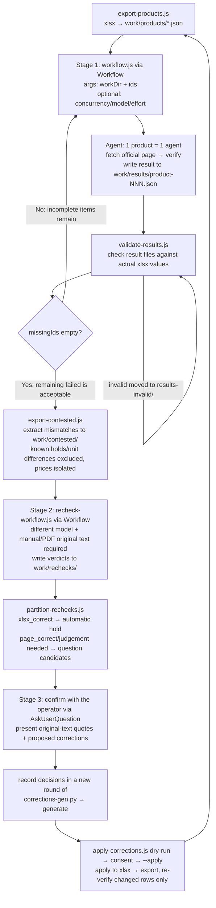

# tools/verify — automatic product spec verification pipeline

> 日本語版は [README.ja.md](README.ja.md) を参照してください.

Verifies each model in `data/audio_interfaces.xlsx` (every column except Measurement Reports) against the official page at its Product Page URL, and reports the discrepancies. A redesign reflecting the lessons from the first run in 2026-07 (interruptions midway, data contamination caused by lost temporary files, and models left unverified by bot protection).

## Overall flow

Three stages: stage 1 = a scan of every item (broadly, with an inexpensive model), stage 2 = examination of discrepancies only (a different model + the manual's original text required, to eliminate false positives), stage 3 = automatic sorting and resolving questions with the operator.



For a large cycle like the first one (hundreds of discrepancies), the bulk review with `propose-corrections.js` + `build-report.js` (discrepancy table = model/column/proposed correction/reason for change/value before, progress in work/review-state.json) can be used instead of stage 2. On either path, settled decisions are recorded in corrections-gen.py and applied with apply-corrections.js.

## Design for resilience to interruption (against resource shortages and usage limits)

- **Checkpoint = result file**: each agent writes `work/results/product-NNN.json` itself when it finishes verifying. Even if the workflow itself or the session dies, completed items remain as files. The workflow's return value is only a progress summary; the files are the authoritative data.
- **A work area that does not disappear**: `work/` is inside the repository (outside git). The per-session scratchpad under /tmp disappears when the session restarts, so it is not used (in the first run, 273 files were lost → agents rebuilt rows from the xlsx on their own → contamination shifted by one row occurred).
- **Recovery does not depend on caches**: on resuming, `validate-results.js` computes `nextIds` from the presence and soundness of the result files, and only those ids are passed to `workflow.js` for a re-run. It can recover even when the Workflow tool's `resumeFromRunId` cache cannot be used (another session, after a script change).
- **Serial execution by default**: an interruption loses only the 1 item in progress. It can be parallelized with `args.concurrency` (a worker-pool scheme. An interruption loses at most concurrency items in progress, all recovered via validate → nextIds). The upper limit on concurrent runs is the Workflow runtime's allowance = min(16, CPU cores − 2).
- **Circuit breaker**: if agents fail `maxConsecFail` times in a row in completion order (default 5), the items not yet started are cut off. This avoids pointlessly failing all remaining items while a usage limit is in effect. After the limit lifts, validate → re-run continues from where it stopped.
- **Model/effort selection**: `args.model` / `args.effort` set the model and effort per agent (inherited from the session when omitted). Verification is a mechanical task, so a lower model is acceptable. Note that validate detects contamination but cannot detect missed discrepancies (false negatives).

## Fetch ladder for reducing unverified (failed) items

Agents try fetching in the following order and leave a log of the attempts in the result's `attempts`:

1. WebFetch
2. `curl -sL --compressed` + a browser User-Agent
3. headless Chrome (`--headless=new --dump-dom --virtual-time-budget=15000` + UA) — a countermeasure to JS challenges such as Cloudflare
4. If everything up to 3 fails with 403 / a challenge, the r.jina.ai reader proxy (fetch `https://r.jina.ai/<listed URL>` with curl, adding `x-no-cache: true` and `x-with-shadow-dom: true`) — what comes back is a body converted from the official page, without iframe contents (`x-with-iframe` requires an API key, and gives 401 without one). Values stated in the output may be used for verification, but something missing from the output is not grounds for "記載なし" (not stated), "新製品なし" (no new products) or "掲載終了" (no longer listed). Missing parts are filled from 5 (screenshot), another presentation on the same official site or the individual product page, and recorded as unconfirmed if they cannot be filled (retail and review sites remain forbidden)
5. A headless Chrome screenshot (`--headless=new --screenshot=<path> --window-size=1280,2000 --virtual-time-budget=20000` + UA) when either of the following holds: `--dump-dom` also gets 403 and the body cannot be obtained with 4 either / the body obtained (including 4's proxy output) lacks items to verify, and they cannot be confirmed in 7's PDF or another page of the same official site either — the rendering result is available only as an image, so read the product name, price, buy button, stated values, etc. by viewing the image with the Read tool. It cannot be extracted as text, but values that could be read are used for verification, and items that cannot be read are recorded as unconfirmed (not_stated in verification). Also useful for confirming that a page exists and is current (track record: fender.com gave 403 to curl/WebFetch/`--dump-dom` alike, but `--screenshot` rendered the product page. 2026-07-18)
6. On 404/redirect, search for the correct page from sitemap.xml on the same official domain and links on the 404 page (record the correct URL as `wrong_page`)
7. The Specifications page on the same official site, datasheet/manual PDFs (parsed with `pdftotext -layout`)
8. Only when the domain of the listed URL has been retired, an official domain owned by the same brand (e.g. focusritepro.com → focusrite.com). Retail and review sites are forbidden

Sites where every method fails, such as with Cloudflare Turnstile, are left as `failed`, and the report lists them in its "Could not be fetched / unverified" section, stating that this does not mean the data is wrong.

## Contamination prevention and soundness validation

- Agent rule: **if the input file cannot be read, do not verify and finish with `failed`** (rebuilding rows from the xlsx or other sources is forbidden). Copy the input file's values into `brand` / `model` (proof of origin).
- `validate-results.js` checks every result file against the actual xlsx values:
  - whether the copied brand/model match the corresponding row (detects verifying a different row = contamination)
  - whether the `xlsx_value` quoted in a mismatch is consistent with the corresponding row's actual value
  - wording that suggests missing input or rebuilding (warning)
- Invalid files are moved to `work/results-invalid/`, automatically treated as incomplete, and re-verified on the next run.

## Operating procedure

```bash
# 1. Generate the input from the xlsx (safe to re-run. Always re-run when the xlsx is updated.
#    Old results of rows whose content changed since the previous export are automatically moved to results-retired/ and become re-verification targets)
node tools/verify/export-products.js

# 2. Start the Workflow in Claude Code (ids: everything the first time, state.json's nextIds when resuming)
#    Workflow({ scriptPath: "<repo>/tools/verify/workflow.js",
#               args: { workDir: "<repo>/tools/verify/work", ids: [...],
#                       concurrency: 8, model: "sonnet", effort: "high" } })
#    concurrency / model / effort are optional (when omitted: serial / inherited from the session / inherited from the session)

# 3. Soundness validation and computing the incomplete ids
node tools/verify/validate-results.js

# 4. Repeat 2-3 until nextIds (= missingIds) is empty.
#    failed (bot protection, etc.) may remain: they are not in nextIds, and the report lists them as unverified.
#    Add --retry-failed / --include-partial only when you want to retry failed / partial
#    (the old results of those targets are moved to results-retired/ and put into nextIds)

# 5. Stage 2: examine only the discrepancies to eliminate false positives (the standard path)
node tools/verify/export-contested.js             # extract mismatches to work/contested/.
#    Discrepancies that are known holds (work/known-holds.json) or only unit differences are excluded automatically,
#    and Reference Price discrepancies are isolated in work/price-diffs.json (to the report's bulk-decision section)
#    → Workflow({ scriptPath: "<repo>/tools/verify/recheck-workflow.js",
#                 args: { workDir: "<repo>/tools/verify/work",
#                         ids: <the array in work/contested-index.json>,
#                         concurrency: 2, model: "<a model different from stage 1>", effort: "high" } })
#    The parallelism of stage 2 is capped at 2 (fixed in the script). Parsing manual PDFs + headless Chrome
#    is memory-heavy: at parallelism 8 the whole Claude Code process crashed, and even 4 was a heavy load (2026-07-12)
#    Agents must consult the manual/datasheet PDF, and for each contested column return
#    a verdict (xlsx_correct / page_correct / judgement_required) + an original-text quote + a proposed correction

# 6. Stage 3: sorting and resolving questions
node tools/verify/partition-rechecks.js           # → work/corrections-recheck.json + draft questions
#    xlsx_correct becomes an automatic hold (no question needed). Only page_correct / judgement_required
#    go to AskUserQuestion per model (original-text quote + proposed correction + apply correction/no change),
#    the operator's decisions are recorded in a new round of work/corrections-gen.py, and corrections-round*.json is generated.
#    A permanent "no change needed" is also added to the gen's KNOWN_HOLDS (excluded automatically from the next cycle on)

# 7. Applying to the xlsx (requires the operator's consent) and confirming consistency
node tools/verify/apply-corrections.js tools/verify/work/corrections-round<N>.json          # dry-run
node tools/verify/apply-corrections.js tools/verify/work/corrections-round<N>.json --apply  # after consent
node tools/verify/export-products.js              # old verification results of changed rows are moved aside automatically → re-verify only those rows to confirm consistency
```

Pre-lint (optional): `node tools/verify/lint-columns.js` detects contradictions between xlsx columns (S/PDIF optical > number of optical ports, ADAT ch not a multiple of 8, etc.) without agents.

### Bulk-review path for large cycles (when there are hundreds of discrepancies, such as the first run)

```bash
# 5'. Creating proposed corrections (when there are high-confidence discrepancies, do this before generating the report)
node tools/verify/propose-corrections.js          # --all also includes low
#    → edit proposed (the raw text stated on the page) in work/corrections-proposal.json into the
#      "corrected cell value" in the xlsx cell format, and save it as work/corrections-edited.json:
#      [{ idx, brand, model, column, confidence?, current, proposed, note?, hold?, unreviewed?, missing? }]
#      - proposed: the corrected cell value. "" blanks the cell (the convention for not equipped / not applicable / unpublished is blank, not 0 or No)
#      - note: a supplement shown in the report / hold: the reason to hold off applying (skipped by apply)
#      - unreviewed: awaiting the operator's confirmation (skipped by apply. Removed by the boundary update of review-state)
#      - missing: a mark for entries from filling blanks (rendered in the report's "Candidates for filling blanks — unconfirmed" section)
#      - Bulk corrections not derived from discrepancies (unifying formats, applying row merges, filling blanks, etc.) can also be added with the same schema
#        (their confidence keys do not match, so they do not appear in the report's discrepancy tables and only take effect in apply)
#    The progress of the operator's review is in work/review-state.json
#    ({ highReviewedUntilIdx, lowReviewedUntilIdx, missingReviewedUntilIdx }).
#    build-report.js hides discrepancy rows in the range already reached and shows only those not yet confirmed.
#    Of missing_in_xlsx (filling blanks), items that cannot be converted mechanically are output as pending to
#    work/missing-pending.json, and build-report.js renders only the pending ones in the "Stated on the official page but blank in the xlsx — held" section

# 6'. Generating the report (product-page-verification-report.md at the repository root. Outside git,
#    regenerated and overwritten on every update, and deleted once the verification cycle is complete)
#    The column layout of the discrepancy tables (the value after the change goes on the left) and the display rules follow what build-report.js generates
#    (operational details in the "Report" section of .claude/skills/verify-products/SKILL.md).
#    Matches with known holds (known-holds.json) are excluded automatically, and price discrepancies are split into a separate section
node tools/verify/build-report.js

# 7'. Applying to the xlsx is the same as step 7 of the standard path (pass corrections-edited.json)
```

When a run is cut off by a usage limit, the procedure is the same: after the limit lifts, just restart via validate → nextIds.

To run completely from 0 (from a state with no results), move the existing `work/results/` to `work/results-archive-<date>/` before entering step 1 (validate computes every item as missingIds).

## Schema of the result files (work/results/product-NNN.json)

| Key | Content |
|---|---|
| brand / model | Copy of Brand / Model from the input file (for origin validation) |
| fetch_status | ok / partial / wrong_page / failed |
| attempts | Fetch attempt log (an array of "method: URL → result") |
| sources | URLs of the pages actually used for verification |
| mismatches | { column, xlsx_value, page_value, confidence: high/low, evidence } |
| not_stated | Names of columns that could not be confirmed from the page |
| missing_in_xlsx | Items with a published value on the page where the xlsx is blank (up to 6) |
| notes | Verification sources and caveats (3 sentences or fewer) |

## Schema of the examination results (work/rechecks/product-NNN.json)

| Key | Content |
|---|---|
| brand / model | Copy of the contested input (for origin validation) |
| fetch_status | ok / partial / failed |
| attempts / sources / notes | Same as the result files |
| verdicts | { column, verdict: xlsx_correct/page_correct/judgement_required, reason: page_omission/marketing_simplification/unit_difference/counting_convention/page_error/xlsx_error/ambiguous, quote (original-text quote + URL), proposed?, note? } |

## Directory structure

```
tools/verify/
├── README.md              ← this document
├── README.ja.md           ← Japanese version of this document
├── lib.js                 ← shared helpers for node scripts (STATUSES/plain/readHeaders/scanResults, etc. The 2 Workflow scripts cannot import it, so they are out of scope)
├── export-products.js     ← xlsx → work/products/*.json
├── workflow.js            ← stage 1: scan of every item (for the Workflow tool. Not run with node)
├── validate-results.js    ← soundness validation, computing nextIds (work/state.json)
├── export-contested.js    ← stage 2 input: extracts mismatches to work/contested/ (known holds/unit differences excluded, prices isolated)
├── recheck-workflow.js    ← stage 2: examination of contested items (for the Workflow tool. Not run with node)
├── partition-rechecks.js  ← stage 3 input: sorting verdicts → work/corrections-recheck.json + draft questions
├── lint-columns.js        ← pre-lint of consistency between columns (no agents needed)
├── build-report.js        ← report generation (known holds excluded automatically, prices in a separate section, pending/applied removals matched by the saved names in removals.json, unaffected by idx shifts)
├── propose-corrections.js ← generates xlsx correction proposals from mismatches (for the bulk review of large cycles)
├── apply-corrections.js   ← applies an agreed correction list to the xlsx (dry-run by default)
└── work/                  ← work area outside git
    ├── products/          ← verification input (JSON per product)
    ├── results/           ← verification results (the authoritative checkpoints)
    ├── results-invalid/   ← where results rejected by validation are moved
    ├── results-retired/   ← where old results replaced by a retry or an xlsx update are moved
    ├── contested/         ← stage 2 input (only models with contested items. export-contested recreates it every time)
    ├── rechecks/          ← stage 2 results (checkpoints)
    ├── contested-index.json      ← target ids of stage 2
    ├── price-diffs.json          ← isolated reference-price discrepancies (the report's bulk-decision section)
    ├── known-holds.json          ← permanent suppression of known holds (the authoritative copy is KNOWN_HOLDS in corrections-gen.py)
    ├── corrections-recheck.json  ← stage 3 sorting result (automatic holds + unreviewed proposed corrections. Intermediate output)
    ├── rows-full.json     ← every xlsx row (idx 0 = sheet row 2)
    ├── state.json         ← validate's tallies, nextIds
    ├── corrections-proposal.json ← correction proposals from propose-corrections.js (raw text stated on the page)
    ├── corrections-gen.py        ← script accumulating proposed corrections and the operator's decisions (FIX/HOLD/KNOWN_HOLDS/rounds, etc.) (the authoritative copy)
    ├── corrections-edited.json   ← output of corrections-gen.py (inserted into the report + apply input. Do not edit directly)
    ├── corrections-round*.json   ← the operator's decisions for each round (output of gen. Apply input)
    ├── review-state.json         ← the idx the operator's review has reached (the range already reached is omitted from the report)
    └── missing-pending.json      ← items of filling blanks that cannot be converted mechanically and await the operator's decision
```
